# Mô tả dự án TD Coffee — Phiên bản hiện tại

> Cập nhật sau khi review toàn bộ source code (backend routes, frontend pages, App.tsx routing).

---

## 1. Tổng quan kiến trúc

```
┌─────────────────────────────────────────────────────────────┐
│                     FRONTEND (Vite + React)                  │
│  localhost:5173  —  mobile-first SPA                         │
│                                                              │
│  Public (PublicLayout)         Staff (StaffShell)            │
│  /           Welcome           /pos          Thu ngân        │
│  /register   Đăng ký           /staff/tables Phục vụ         │
│  /menu       Menu đặt món      /kds          Bếp             │
│  /product/:id Chi tiết món     /staff/inventory Kiểm kho     │
│  /cart       Giỏ hàng          /staff/schedule  Lịch làm     │
│  /order/:id/grace  Ân hạn                                    │
│  /order/:id/checkout Thanh toán online                       │
│  /account    Tài khoản khách                                 │
│  /about      Trang giới thiệu (Posts)                        │
│  /vnpay-return VNPay callback                                │
│                                                              │
│  Admin (StaffRoute – role=Admin)                             │
│  /admin          Trang quản trị tổng hợp                     │
│  /admin/formulas Công thức nguyên liệu                       │
│  /admin/schedule Lịch làm việc (Admin view)                  │
└──────────────────────┬──────────────────────────────────────┘
                       │ HTTP REST + Socket.io
                       ▼
┌─────────────────────────────────────────────────────────────┐
│                BACKEND (Express + Prisma + Socket.io)        │
│  localhost:4000                                              │
│  MySQL (Docker, port 3307) + Redis (Docker)                  │
└─────────────────────────────────────────────────────────────┘
                       │ (tùy chọn)
                       ▼
┌─────────────────────────────────────────────────────────────┐
│           AI Service (Python FastAPI) — localhost:8000       │
│  GET /recommendations?customer_id=  (mock Top 3)            │
└─────────────────────────────────────────────────────────────┘
```

---

## 2. Các tác nhân (Actors)

| Actor | Mô tả |
|-------|-------|
| **Khách hàng (Guest)** | Khách vãng lai, không đăng nhập |
| **Khách hàng (Registered)** | Khách có tài khoản (SĐT/email + mật khẩu) |
| **Thu ngân (Cashier)** | Nhân viên thu ngân, mở/đóng ca, thanh toán tại quầy |
| **Phục vụ (Waiter)** | Nhân viên bàn, quản lý sơ đồ bàn, gọi món hộ |
| **Bếp (Kitchen)** | Nhân viên bếp, xử lý màn hình KDS |
| **Quản lý (Admin)** | Toàn quyền hệ thống |

---

## 3. Sơ đồ Use Case — toàn hệ thống

```mermaid
flowchart TD
    GU["👤 Khách vãng lai"]
    KH["👤 Khách đăng nhập"]
    TN["👤 Thu ngân"]
    PV["👤 Phục vụ"]
    BEP["👤 Bếp"]
    ADM["👤 Admin"]

    subgraph PUBLIC["🌐 Kênh Khách Hàng (Public)"]
        direction TB
        UC01["Xem trang giới thiệu / bài đăng"]
        UC02["Xem menu & tìm kiếm món"]
        UC03["Xem chi tiết món"]
        UC04["Đăng ký tài khoản"]
        UC05["Đăng nhập SĐT/email"]
        UC06["Thêm vào giỏ hàng"]
        UC07["Đặt món (tại bàn / mang về)"]
        UC08["Ân hạn 60s — hủy đơn"]
        UC09["Xem bill & trạng thái đơn"]
        UC10["Thanh toán online VNPay / MoMo / SePay"]
        UC11["Áp dụng điểm thưởng"]
        UC12["Nhập mã voucher"]
        UC13["Gửi yêu cầu thanh toán tới POS"]
        UC14["Đánh giá đơn hàng"]
        UC15["Xem lịch sử đơn & điểm tích lũy"]
        UC16["Cập nhật hồ sơ cá nhân"]
        UC17["Xem & lưu voucher cá nhân"]
        UC18["Chat bot hỗ trợ"]
    end

    subgraph POS_SCREEN["🖥️ POS — Thu ngân"]
        direction TB
        UC20["Mở ca (nhập tiền đầu ca)"]
        UC21["Đóng ca (đếm tiền thực tế)"]
        UC22["Xem danh sách đơn chờ thanh toán"]
        UC23["Thanh toán tiền mặt / chuyển khoản"]
        UC24["Áp dụng điểm / voucher tại quầy"]
        UC25["Xem lịch sử bill trong ngày (20 ngày)"]
        UC26["Nhận thông báo realtime đơn mới & yêu cầu TT"]
    end

    subgraph STAFF_TABLES["🍽️ Sơ đồ bàn — Phục vụ"]
        direction TB
        UC30["Xem sơ đồ bàn realtime"]
        UC31["Gọi món cho khách tại bàn"]
        UC32["Hủy món trong 20 giây"]
        UC33["Gộp đơn (merge orders)"]
        UC34["Yêu cầu thanh toán cho bàn"]
        UC35["Đánh dấu bàn sạch"]
        UC36["Xem lịch làm việc cá nhân"]
        UC37["Đăng ký ca làm việc"]
    end

    subgraph KDS_SCREEN["🔧 KDS — Bếp"]
        direction TB
        UC40["Xem queue món cần pha chế"]
        UC41["Cập nhật trạng thái món (Waiting→Cooking→Ready)"]
        UC42["Thông báo món sẵn sàng cho phục vụ"]
        UC43["Tạo phiếu yêu cầu nhập nguyên liệu"]
        UC44["Xem lịch làm việc cá nhân"]
        UC45["Đăng ký ca làm việc"]
    end

    subgraph INVENTORY["📦 Kiểm kho — Nhân viên"]
        direction TB
        UC50["Kiểm kho đầu ca (ghi số thực tế)"]
        UC51["Kiểm kho kết ca"]
        UC52["Tạo phiếu yêu cầu nhập hàng (nhiều dòng)"]
        UC53["Xem danh sách phiếu của mình"]
    end

    subgraph ADMIN_PANEL["⚙️ Admin Panel"]
        direction TB
        UC60["Xem dashboard thống kê (hôm nay / tuần / tháng)"]
        UC61["Quản lý sản phẩm (CRUD + upload ảnh)"]
        UC62["Quản lý danh mục"]
        UC63["Quản lý nhân viên (tạo / sửa / vô hiệu hóa)"]
        UC64["Quản lý khách hàng (sửa / reset mật khẩu)"]
        UC65["Quản lý bàn (QR code)"]
        UC66["Quản lý kho nguyên liệu (CRUD)"]
        UC67["Duyệt phiếu nhập hàng → nhập kho tự động"]
        UC68["Xem phiếu nhập kho lịch sử"]
        UC69["Quản lý voucher (tạo / sửa / auto-gift)"]
        UC70["Xem & trả lời đánh giá khách hàng"]
        UC71["Cấu hình cửa hàng (VAT, điểm, GPS)"]
        UC72["Báo cáo doanh thu theo ngày (biểu đồ + CSV)"]
        UC73["Báo cáo top sản phẩm"]
        UC74["Báo cáo lợi nhuận (doanh thu - giá vốn)"]
        UC75["Xuất CSV đơn hàng"]
        UC76["Quản lý công thức nguyên liệu / món"]
        UC77["Quản lý lịch làm việc (duyệt / chốt ca)"]
        UC78["Quản lý bài đăng / tin tức (CRUD)"]
        UC79["Xem nhật ký hệ thống (Audit Log)"]
        UC80["Quản lý nhà cung cấp"]
    end

    GU --> UC01 & UC02 & UC03 & UC06 & UC07
    KH --> UC01 & UC02 & UC03 & UC05 & UC06 & UC07 & UC08 & UC09
    KH --> UC10 & UC11 & UC12 & UC13 & UC14 & UC15 & UC16 & UC17 & UC18
    GU --> UC04

    TN --> UC20 & UC21 & UC22 & UC23 & UC24 & UC25 & UC26
    TN --> UC50 & UC51 & UC52 & UC53
    TN --> UC36 & UC37

    PV --> UC30 & UC31 & UC32 & UC33 & UC34 & UC35
    PV --> UC36 & UC37
    PV --> UC50 & UC51 & UC52 & UC53

    BEP --> UC40 & UC41 & UC42 & UC43
    BEP --> UC44 & UC45
    BEP --> UC52 & UC53

    ADM --> UC60 & UC61 & UC62 & UC63 & UC64 & UC65 & UC66 & UC67
    ADM --> UC68 & UC69 & UC70 & UC71 & UC72 & UC73 & UC74 & UC75
    ADM --> UC76 & UC77 & UC78 & UC79 & UC80
    ADM --> UC20 & UC21 & UC22 & UC23 & UC24 & UC25
    ADM --> UC30 & UC31 & UC32 & UC33 & UC34 & UC35
    ADM --> UC40 & UC41 & UC42 & UC43
    ADM --> UC50 & UC51 & UC52 & UC53
```



---

## 4. Chi tiết chức năng theo nhóm

### 4.1 Khách hàng (Guest + Registered)

| Use Case | Trang | Ghi chú |
|----------|-------|---------|
| Xem trang giới thiệu & bài đăng | `/about` | StorePage — bài đăng do Admin tạo |
| Xem menu & lọc theo danh mục | `/menu` | Bao gồm tìm kiếm, lọc, gợi ý AI (Top 3) |
| Xem chi tiết sản phẩm | `/product/:id` | ProductDetail |
| Đăng ký tài khoản | `/register` | SĐT / email + mật khẩu; tặng voucher chào mừng |
| Đăng nhập | `/` (Welcome) | SĐT/email + mật khẩu; hoặc tiếp tục không đăng nhập |
| Thêm giỏ, đặt món | `/cart` → POST `/orders` | Dine-in (cần tableId) hoặc Takeaway (sessionId) |
| Ân hạn 60s hủy đơn | `/order/:id/grace` | Đơn tại bàn — POST `/orders/:id/cancel` |
| Xem bill & trạng thái | `/order/:id/checkout` | GET `/orders/:id/bill` |
| Thanh toán online | `/order/:id/checkout` | VNPay / MoMo / SePay (webhook) |
| Áp dụng điểm thưởng | `/order/:id/checkout` | POST `/orders/:id/redeem-points` |
| Nhập mã voucher | `/order/:id/checkout` | POST `/vouchers/validate-public` |
| Gửi yêu cầu TT tới POS | `/order/:id/checkout` | POST `/orders/:id/request-payment` |
| Đánh giá đơn (sau Paid) | `/account` | POST `/reviews` |
| Xem lịch sử đơn & điểm | `/account` | GET `/auth/me` |
| Cập nhật hồ sơ | `/account` | PATCH profile |
| Xem & lưu voucher cá nhân | `/account` | GET `/vouchers/my`, POST `/vouchers/claim` |
| Chat bot | Widget (tất cả trang) | `/api/chat` — wifi, WC; escalate socket |

### 4.2 Thu ngân (Cashier / Admin)

| Use Case | Trang | Ghi chú |
|----------|-------|---------|
| Mở ca | `/pos` | POST `/shifts/open` — nhập tiền đầu ca |
| Đóng ca | `/pos` | POST `/shifts/close` — đếm tiền thực tế |
| Xem đơn chờ thanh toán | `/pos` | GET `/pos/pending-orders` (realtime socket) |
| Thanh toán tiền mặt | `/pos` | POST `/pos/pay` method=Cash |
| Thanh toán chuyển khoản | `/pos` | POST `/pos/pay` method=Transfer |
| Áp dụng điểm tại quầy | `/pos` | POST `/pos/pay` với pointsToUse |
| Kiểm tra & áp dụng voucher | `/pos` | POST `/vouchers/validate` + `/vouchers/apply` |
| Xem lịch sử bill | `/pos` | GET `/pos/bills?date=` (20 ngày gần nhất) |
| Nhận thông báo realtime | `/pos` | Socket: `order:pending_grace`, `payment:request`, `inventory:request` |

### 4.3 Phục vụ (Waiter / Admin)

| Use Case | Trang | Ghi chú |
|----------|-------|---------|
| Xem sơ đồ bàn | `/staff/tables` | GET `/pos/tables` + Socket realtime |
| Gọi món cho bàn | `/staff/tables` | POST `/staff/tables/:id/items` |
| Hủy món trong 20 giây | `/staff/tables` | POST `/staff/orders/:orderId/items/:detailId/cancel` |
| Gộp đơn | `/staff/tables` | POST `/staff/orders/merge` |
| Yêu cầu thanh toán | `/staff/tables` | POST `/staff/orders/request-payment` |
| Đánh dấu bàn sạch | `/staff/tables` | POST `/staff/tables/:id/clean` |
| Xem lịch làm việc | `/staff/schedule` | GET `/schedule/my` |
| Đăng ký ca làm việc | `/staff/schedule` | POST `/schedule/bulk` |

### 4.4 Bếp (Kitchen / Admin)

| Use Case | Trang | Ghi chú |
|----------|-------|---------|
| Xem queue KDS | `/kds` | GET `/kds/queue` — Waiting + Cooking |
| Cập nhật trạng thái món | `/kds` | PATCH `/kds/details/:id` — Hold→Waiting→Cooking→Ready |
| Thông báo món ready | `/kds` | Socket emit `kds:ready` → màn hình phục vụ |
| Tạo phiếu nhập nguyên liệu | `/kds` hoặc `/staff/inventory` | POST `/kitchen/requests` |
| Xem lịch làm việc | `/staff/schedule` | GET `/schedule/my` |
| Đăng ký ca làm việc | `/staff/schedule` | POST `/schedule/bulk` |

### 4.5 Kiểm kho (Cashier / Waiter / Kitchen / Admin)

| Use Case | Trang | Ghi chú |
|----------|-------|---------|
| Kiểm kho mở ca | `/staff/inventory` | POST `/shifts/inventory/check` checkType=open |
| Kiểm kho kết ca | `/staff/inventory` | POST `/shifts/inventory/check` checkType=close |
| Tạo phiếu yêu cầu nhập hàng | `/staff/inventory` | POST `/staff/inventory/requests` (nhiều dòng) |
| Xem phiếu của mình | `/staff/inventory` | GET `/staff/inventory/requests` |
| Xem log kiểm kho | `/staff/inventory` | GET `/shifts/inventory/log?date=` |

### 4.6 Admin (toàn quyền)

| Nhóm chức năng | Trang | API |
|----------------|-------|-----|
| **Dashboard** thống kê hôm nay/tuần/tháng | `/admin` | GET `/admin/stats` |
| **Sản phẩm**: CRUD, upload ảnh, ẩn/hiện | `/admin` | `/admin/products`, `/admin/upload-image` |
| **Danh mục**: CRUD, sắp xếp thứ tự | `/admin` | `/admin/categories` |
| **Nhân viên**: tạo/sửa/vô hiệu hóa, tự sinh username | `/admin` | `/admin/staff` |
| **Khách hàng**: sửa thông tin, reset mật khẩu, điểm, hạng | `/admin` | `/admin/customers` |
| **Bàn**: CRUD bàn, tạo QR code | `/admin` | `/admin/tables` |
| **Kho nguyên liệu**: CRUD, nhập kho tức thì | `/admin` | `/admin/inventory` |
| **Duyệt phiếu nhập**: Approved → tăng stockQty + tạo StockReceipt | `/admin` | PATCH `/admin/requests/:id` |
| **Lịch sử nhập kho**: xem phiếu theo ngày | `/admin` | GET `/admin/receipts` |
| **Voucher**: tạo/sửa/khóa, auto-gift toàn bộ khách | `/admin` | `/vouchers/admin` |
| **Đánh giá**: xem, ẩn, trả lời | `/admin` | GET/PATCH `/admin/reviews` |
| **Cài đặt**: VAT, điểm, GPS radius | `/admin` | GET/PATCH `/admin/settings` |
| **Báo cáo doanh thu**: biểu đồ ngày, xuất CSV | `/admin` | `/admin/reports/revenue`, `/admin/export/revenue.csv` |
| **Báo cáo đơn hàng**: chi tiết + xuất CSV | `/admin` | `/admin/reports/orders`, `/reports/orders/export` |
| **Top sản phẩm** | `/admin` | `/reports/top-products` |
| **Lợi nhuận gộp** (doanh thu - giá vốn - nhập kho) | `/admin` | `/reports/profit` |
| **Công thức nguyên liệu**: định nghĩa tỷ lệ nguyên liệu mỗi món | `/admin/formulas` | `/formula` |
| **Lịch làm việc**: xem tất cả, duyệt/từ chối/chốt ca | `/admin/schedule` | `/schedule/admin/all`, PUT `/schedule/:id`, POST `/schedule/admin/publish` |
| **Bài đăng tin tức**: CRUD, ẩn/hiện, ghim | `/admin` | `/posts`, `/posts/admin` |
| **Nhà cung cấp**: CRUD | `/admin` | `/admin/supplier` (route `/supplier`) |
| **Audit Log**: nhật ký hành động hệ thống | `/admin` | GET `/admin/audit-log` |

---

## 5. Luồng chính quan trọng

### 5.1 Luồng đặt món tại bàn (QR → Dine-in)
```
QR Code (?idtable=X)
  → / (Welcome) → Đăng nhập / Tiếp tục không đăng nhập
  → /menu → chọn món → /cart
  → POST /orders (status=Pending_Grace, graceEndsAt=+60s)
  → /order/:id/grace (60 giây đếm ngược)
     ├─ Hủy trong 60s → status=Cancelled
     └─ Hết 60s → graceWorker → status=Confirmed → emit socket order:new → KDS nhận
  → /order/:id/checkout (xem bill, áp điểm, voucher, yêu cầu TT)
  → POS nhận payment:request → thanh toán → status=Paid
  → emit payment:success → KDS nhận, bàn → Empty
```

### 5.2 Luồng đặt món mang về (Takeaway)
```
/menu → /cart (chọn Mang về)
  → POST /orders (status=Confirmed ngay, sessionId=UUID)
  → KDS KHÔNG nhận ngay (kdsStatus=Hold)
  → /order/:id/checkout → thanh toán trước (VNPay/MoMo/Cash)
  → Sau thanh toán: Hold→Waiting → emit order:new → KDS pha chế
```

### 5.3 Luồng thanh toán VNPay
```
/order/:id/checkout → POST /vnpay/create-payment-url
  → Redirect sang VNPay
  → VNPay redirect → /vnpay-return
  → GET /vnpay/return (verify, update Payment + Order=Paid)
  → emit payment:done
```

### 5.4 Luồng lịch làm việc
```
Nhân viên: /staff/schedule
  → POST /schedule/bulk (tuần này hoặc tuần tới)
  → Status = PENDING
  → Admin: /admin/schedule → xem tổng hợp → duyệt từng ca hoặc "Chốt tuần"
  → PUT /schedule/:id (status=APPROVED/REJECTED)
  → emit socket schedule:updated → nhân viên nhận thông báo
```

### 5.5 Luồng voucher tự động
```
Khách đăng ký mới → autoGiftWelcomeVoucher() → tặng voucher "Chào mừng"
Admin tạo voucher → autoGift=true → tặng luôn cho tất cả khách hiện tại
Admin tạo voucher → emit socket voucher:new → thông báo tới khách
Khách xem /account → lưu vào ví → POST /vouchers/claim
Thanh toán → POST /vouchers/validate-public → POST /vouchers/apply
```

---

## 6. Sự kiện Socket.io (realtime)

| Sự kiện | Hướng | Mô tả |
|---------|-------|-------|
| `order:pending_grace` | Server → POS | Đơn mới vừa đặt |
| `order:confirmed` | Server → POS | Đơn xác nhận (sau grace) |
| `order:new` | Server → KDS | Đơn xuống bếp |
| `payment:request` | Server → POS | Khách / phục vụ yêu cầu TT |
| `payment:done` | Server → POS | Thanh toán hoàn tất |
| `payment:success` | Server → Khách | Xác nhận TT thành công |
| `kds:update` | Server → Staff | Cập nhật trạng thái món |
| `kds:ready` | Server → Staff | Món sẵn sàng phục vụ |
| `chat:escalate` | Server → Staff | Chat bot chuyển tiếp |
| `voucher:new` | Server → All | Voucher mới được tạo |
| `inventory:request` | Server → POS | Bếp yêu cầu nguyên liệu |
| `inventory:restock_request` | Server → POS | NV tạo phiếu nhập hàng |
| `schedule:new` | Server → admin_room | NV gửi đăng ký ca |
| `schedule:updated` | Server → Staff + admin | Ca được duyệt/từ chối |
| `schedule:published` | Server → Staff + admin | Admin chốt ca tuần |
| `schedule:deleted` | Server → Staff + admin | Ca bị xóa |

---

## 7. Những điểm khác với mô tả ban đầu

| Điểm khác | Ban đầu | Hiện tại |
|-----------|---------|---------|
| Hệ thống voucher | Không có | Đầy đủ: public/personal, giờ vàng, auto-gift, ví voucher |
| Lịch làm việc | Không có | Đầy đủ: đăng ký ca, duyệt, chốt tuần, thông báo realtime |
| Báo cáo | Chưa chi tiết | Doanh thu, đơn hàng, top sản phẩm, lợi nhuận, xuất CSV |
| Kiểm kho | Cơ bản | Log kiểm kho mở/kết ca, phiếu nhập hàng nhiều dòng |
| Bài đăng tin tức | Không có | CRUD đầy đủ với ghim, ẩn/hiện, rich text |
| Nhà cung cấp | Không có | CRUD nhà cung cấp trong admin |
| Công thức nguyên liệu | Không có | Trang `/admin/formulas` định nghĩa tỷ lệ nguyên liệu |
| Thanh toán | Chỉ đề cập | Tích hợp VNPay + MoMo + SePay (webhook) |
| Gộp đơn | Không có | POST `/staff/orders/merge` |
| Hủy món 20 giây | Không có | POST cancel detail trong 20s |
| Audit Log | Không có | Ghi log mọi thao tác quan trọng |
| Hạng khách hàng | Đề cập | Tính từ tổng chi tiêu (Đồng/Bạc/Vàng/Kim cương) |

---

## 8. Tài khoản demo

| Loại | Username | Mật khẩu | Trang |
|------|----------|----------|-------|
| Khách hàng | `0900000000` | `123456` | `/menu` |
| Admin | `admin` | `staff123` | `/admin` |
| Thu ngân | `cashier` | `staff123` | `/pos` |
| Phục vụ | `waiter` | `staff123` | `/staff/tables` |
| Bếp | `kitchen` | `staff123` | `/kds` |

---

## 9. Stack kỹ thuật

| Thành phần | Công nghệ |
|------------|-----------|
| Frontend | Vite + React 18 + TypeScript, React Router v6 |
| Backend | Node.js + Express + TypeScript |
| ORM | Prisma (MySQL) |
| Realtime | Socket.io |
| Database | MySQL 8 (Docker) |
| Cache | Redis (Docker) |
| AI Service | Python FastAPI (mock) |
| Thanh toán | VNPay, MoMo, SePay |
| Auth | JWT (staff) + bcrypt (khách) |
